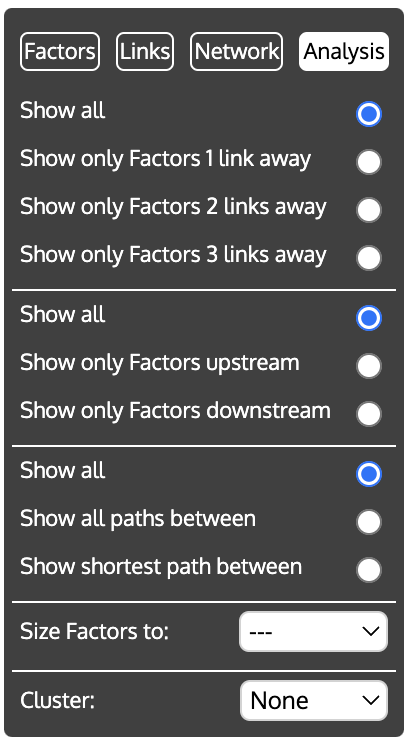
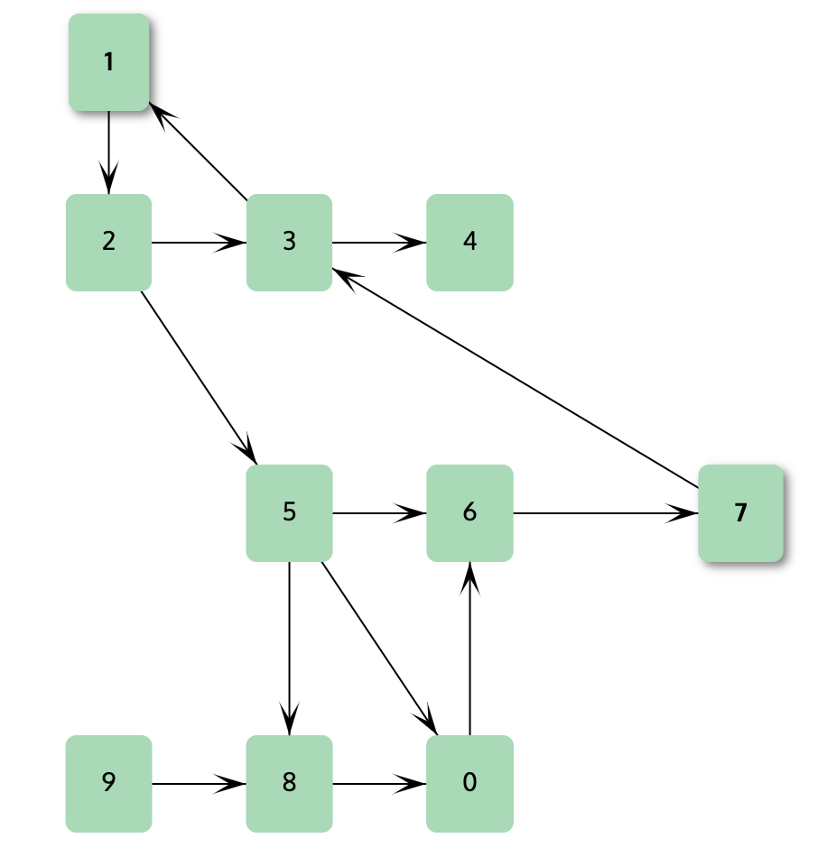
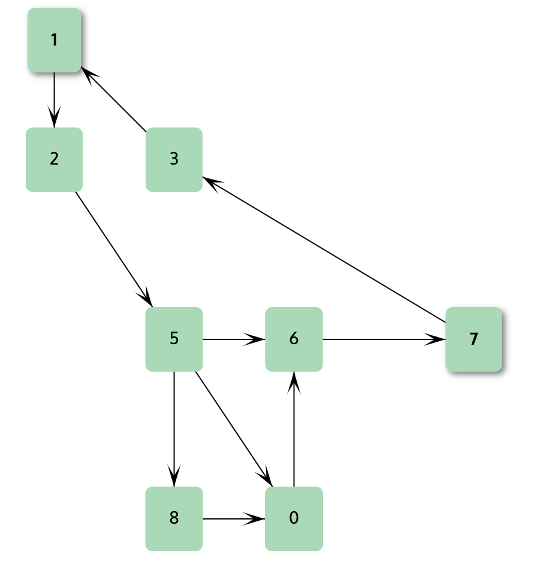
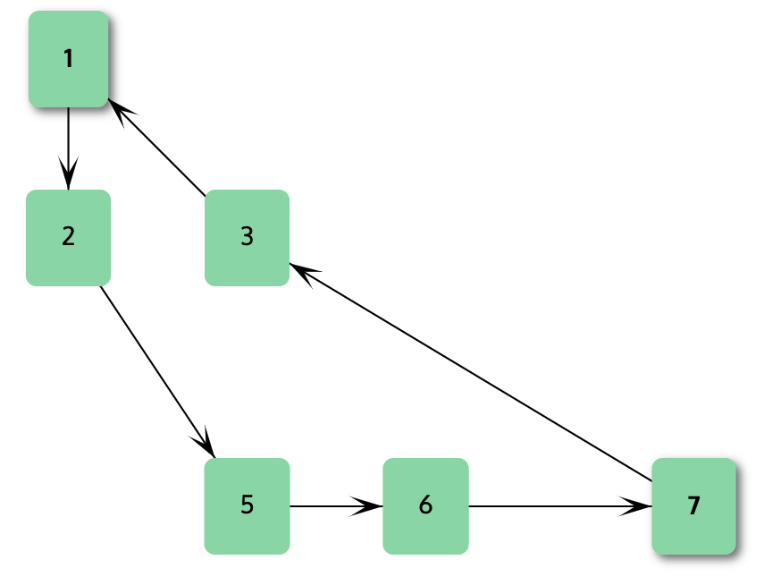
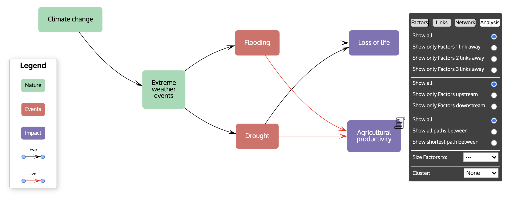
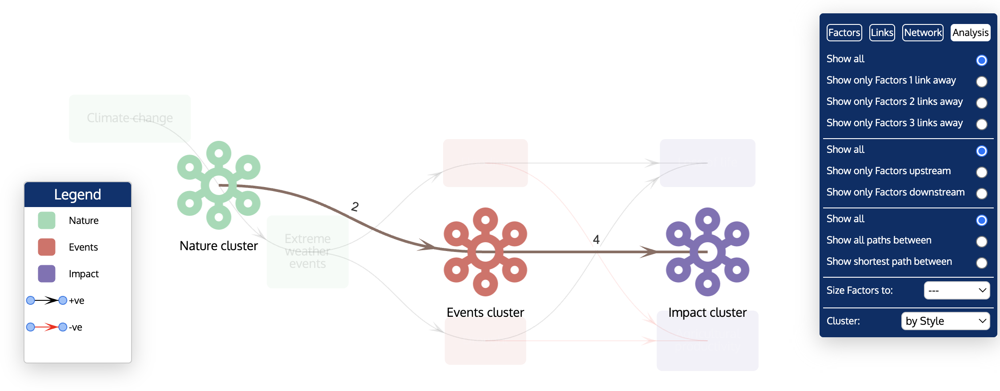

> For AI agents: the complete documentation index is available at /doc/help4/doc_build/llms.txt, the full documentation bundle is available at /doc/help4/doc_build/llms-full.txt.

# Analysing the map

:::warning Draft
This page has not yet been fully revised for PRSM 4 and may describe the legacy app. See the [PRSM 4 overview](/doc/help4/doc_build/manual/Introduction.md) for current guidance.
:::

Once you have a map, you may want to examine it for themes and patterns. This is easiest if you examine portions of the map, or 'sub-maps', one at a time.  PRSM includes several features to make this easier. These are located on the Analysis tab of the Settings dialog.

## Using PRSM for map analysis

As  Barbrook-Johnson and Penn ([2021](https://doi.org/10.1177/1356389020976153)) explain, network analysis can be combined with subjective information to answer a range of questions, as indicated in the table below.

| **Way to start
** | **Starting point options
** | **How to build
** | **Interpretation
** | **How to do it with PRSM
** |
| --- | --- | --- | --- | --- |
| **Stakeholder-suggested factors
** | Intervention or controllable factors | Downstream factors and edges | What is the intervention or controllable factor affecting? Unexpected indirect effects? | Select the intervention factor and choose ‘Show only Factors downstream’ |
| For multiple factors create a union or intersection of multiple downstream submaps | How are multiple interventions complementing or clashing with each other? | Select all the interventions and choose ‘Show only Factors downstream’ |
| Paths between intervention factors and outcome factors, including ego networks of factors on paths | What does the intervention rely on to achieve its goals? What wider context might affect it? | Select all the factors on the path(s) between the intervention(s) and the outcomes(s), and choose ‘Show only Factors 1 link away’ (or 2 or 3 links away) |
| Important or outcome factors | Upstream factors and edges | What is influencing the thing we care about? Constraints? Control? Buffered or buffeted? | Select the intervention factor and choose ‘Show only Factors upstream’ |
| For multiple factors create a union or intersection of ego networks. Or, pull out paths between outcomes. | What trade-offs or synergies might there be between achieving the things we care about? | Select all the interventions and choose ‘Show only Factors upstream’ |
| Ego networks | What is influencing the thing we care about, what does it influence and how do those things interact? | Select the factor and choose ‘Show only Factors 1 link away’ (or 2 or 3 links away) |
| Union or intersection of upstream factors and edges | What factors influence multiple outcomes? Identify potential levers in the system, co-benefits, synergies, or risks. | Select all the outcome factors and choose ‘Show only Factors upstream’ |
| Vulnerable to change factors | Up and/or downstream factors and edges | What might mitigate change in this factor? What impact might change have? | Select one or more factors and choose ‘Show only Factors 1 link away’ (or 2 or 3 links away) |
| Union/intersection multiple downstream sub maps | Are there compound risks, how might interventions interact with external change? | Select factors and choose ‘Show only Factors downstream’ |
| --- |
| **System-suggested factors
** | Influential (i.e. many outgoing connections) | Downstream factors and edges | What is this influential thing affecting? Vulnerability or lever? | First, set ‘Size Factors to: Outputs’ to see which factors have many outgoing connections. Then select an influential factor and choose ‘Show only Factors downstream’. |
| Central to the map (i.e. well-connected, or bridging) | Downstream and/or upstream factors and edges | What is influencing this central factor? What influence does it have? Bottleneck, bridge, transmitter? | First, set ‘Size Factors to: Centrality’ to see which factors are central. Then select a central factor and choose ‘Show only Factors upstream’. |
| Ego networks | What does this factor bridge or connect? | First, set ‘Size Factors to: Centrality’ to see which factors are central. Then select a central factor and choose ‘Show only Factors 1 link away’. |
| Influenced (i.e. many incoming connections) | Upstream factors and edges | What is influencing this highly influenced factor? Buffered or buffeted? | First, set ‘Size Factors to: Inputs’ to see which factors have many incoming connections. Then select a factor and choose ‘Show only Factors upstream'. |
| Unusual network property | Any of the above | Does this factor play an important but counter-intuitive role in the system? | Set ‘Size Factors to: Leverage’ to see which factors have either many incoming but few outgoing connections or few outgoing but many incoming connections. |

With thanks to Alex Penn and Pete Barbrook-Johnson for the original of this table, adapted from

[Barbrook-Johnson, P., & Penn, A. (2021). Participatory systems mapping for complex energy policy evaluation. _Evaluation_, 27(1), 57–79](https://doi.org/10.1177/1356389020976153).

## The Analysis panel

The Analysis panel allows you to view portions of the map and to cluster factors to help with the analysis of the network.

The panel is divided into sections:

### Focusing on parts of the map

- **Show only neighbouring Factors** If you first select a factor (or several factors) and then one of these options, all factors in the network will be hidden, except for those 1, 2, or 3 links away from the selected factor(s).  This is useful when you want to focus on just one part of a large network.
- **Show only up or downstream Factors**  If you first select a factor (or several factors) and then one of these options, all factors in the network will be hidden, except for those 'downstream' (i.e. linked to the selected factor(s) by following links directed _away_ from those factor(s)), or those 'upstream' (i.e. linked to the selected factor(s) by following links directed _towards_ those factor(s)).
- **Show paths between** If you first select at least two factors, and then

  - **Show all paths between**, only those links that lie on a path between the selected factors will be shown.  A 'path' is a set of links that, following the direction of the arrows, connects two factors.  There may be several ways of getting from one factor to another; if so, all the paths are shown.  All factors that do not lie on the connecting paths are hidden.
  - **Show shortest path between** displays only the path with the fewest links between the selected factors (if there are two shortest paths with same number of links, only one, chosen arbitrarily, is shown).

  For both these options, all the selected factors in turn are used as the starting point for the paths, and all other factors are used as the end points.  For example, if factors A, B and C are selected, paths from A to B, A, to C, B to A, B to C , C to A and C to B will be shown (if they exist).  This has the incidental use of identifying 'loops' that could indicate feedbacks.  If there is a path from A to B _and_ a path from B to A, the effect of A on B will feedback on A.

Here is an example.  The first is the original network.

The second is the same network with **Show all paths** between Factors 1 and 7. Notice that Factors 4 and 9 are not on any path.

The third is the same network with **Show shortest path** between Factors 1 and 7.

The above three options can be combined.  For example, the shortest path between two Factors option may display two paths: one with a couple of links and another feedback path going in the reverse direction that winds around the map and includes many links.  Because it consists of many links, the latter path may not be of much interest.  Choosing both **Show Shortest path** and **Show only Factors 2 links away** will display just the direct path.

### Emphasising important factors

- **Size Factors to** This is used to change the size of the factors to be proportional to one of a set of metrics: the number of inputs (the 'in-degree'), the number of outputs (the 'out-degree'), the leverage (ratio of outputs to inputs), or the [betweenness centrality](https://en.wikipedia.org/wiki/Betweenness_centrality).  Note that the factors are always drawn large enough to accommodate their labels, and so the size may not be exactly proportional to the metric.  The  values of leverage and betweenness centrality of a factor are shown in its Notes panel.

### Clustering factors to reduce complexity

- **Cluster** With large maps, it is sometimes useful to aggregate factors into groups, thus displaying the map at a higher level of abstraction. For example, all the factors relating to the effect of climate change might be replaced on the map by one 'Climate Change Cluster' factor, and similarly, all the factors concerned with transport replaced by one Transport factor. Links that used to go to factors outside the cluster are replaced by links that go to the new Cluster factor (and likewise for links that go from the clustered factors to factors outside the cluster).

  For example, here is a simple map before clustering:

and here is the same map after clustering by Style:

Links to and from cluster factors are labelled with the number of links that they aggregate.

Clustering is done according to the values of  the clustering attribute - all factors with the same value for this attribute are joined into the same cluster.  The **Cluster** pull-down menu offers **Style** (i.e. the factors' style as set in the [Factors tab](/doc/help4/doc_build/manual/Styling.md#factors-tab)) **Colour** (i.e. the colour of the factors' backgrounds) and **Community** (see below) as possible attributes with which to cluster.  In addition, bespoke attributes can be used by creating a new column in the Data View and giving each factor a value there (see the section on the [Data View](/doc/help4/doc_build/manual/DataView.md#data-view) for how to create attributes).  These additional attributes are automatically added to the Cluster pull-down menu when they are created.

A cluster factor must include more than one ordinary factor, so if the clustering attribute for a factor is is unique to that factor (no other factor has the same value for the attribute) it will remain outside any cluster.  If the value of the clustering attribute in the Data View is blank for a factor, that factor will also remain unclustered.

In addition to these ways of clustering by factor attributes, one can also cluster factors into 'communities'.  Communities are defined by the strength of their links to other factors using the [Louvain cluster detection algorithm](https://arxiv.org/pdf/0803.0476).  The strength of a link is assumed to be 1 unless a numerical attribute called 'weight' has been defined (in the [Data View](/doc/help4/doc_build/manual/DataView.md#data-view)), in which case the strengths are those given by this attribute.

Once the map has been clustered, a cluster factor can be 'unclustered' (its component factors revealed) by right (CTRL) clicking it, and reclustered by right (CTRL) clicking any of the component factors.  To uncluster the map as a whole, select None from the Cluster pull-down menu.

Cluster factors can be edited just like ordinary factors, by double clicking them, for example to change their shape, label or border.
